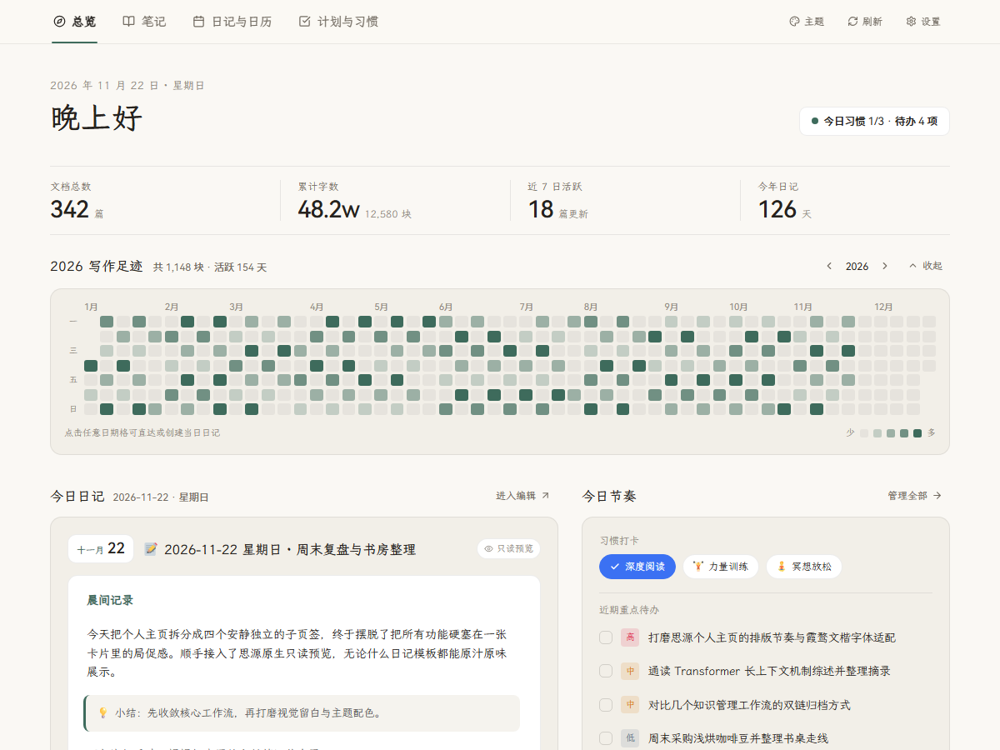

# Personal Home (`siyuan-personal-home`)

[简体中文](./README.zh-CN.md) | **English**

A calm, editorial-style personal home tab for [SiYuan Note](https://github.com/siyuan-note/siyuan) — unifying note analytics, an annual writing heatmap, a daily-note calendar with native read-only preview, Notebook Navigator-style note browsing, dual-dimension habit tracking, and lightweight due-date-free tasks in a single clean custom tab.



## Features

- **Four-Tab Editorial Studio (`Overview` / `Notes` / `Journal & Calendar` / `Plan & Habits`)**: Opens as a single-instance custom tab (`Alt+Shift+H` or one top-bar icon) without cluttering sidebar docks.
- **Note Stats & 53-Week Heatmap**: Tracks total documents, total words & blocks, 7-day activity, and annual diary days, with click-to-open or create any date's daily note.
- **Daily Note Calendar & Native Read-Only Preview**: Syncs with SiYuan's active diary notebook (`local-dailynoteid`) and embeds SiYuan's native read-only `Protyle` viewer — compatible with any daily note template, AttributeView databases, embeds, callouts, images, and HTML widgets.
- **Notebook Navigator-Style Note Browser**: Switch between Recently Modified and Recently Read (1.5s dwell tracking), List & 2-Column Grid views, date grouping, clickable `#tag` filtering, customizable preview lines (0–5, justify, first-line indent), and multi-ID hiding (notebooks and parent document subtrees).
- **Habit Tracker & Due-Date-Free Tasks**: Daily streaks and weekly goal streaks with a 7-day week strip, backfill & duration logging, plus priority/category-grouped tasks with optional SiYuan document links and zero due-date anxiety.
- **Independent Theme Studio & Font Inheritance**: Ships with 4 Light and 4 Dark built-in palettes plus a custom 6-color Theme Studio, completely decoupled from SiYuan host colors while optionally inheriting your SiYuan editor font.
- **Sync-Friendly Private Storage**: Stores data in SiYuan's plugin storage with per-record LWW merge, 30-day tombstone GC, `sync-end` hot reload, and JSON backup import/export.

## Usage

1. Install **Personal Home** from the SiYuan Community Bazaar and enable it.
2. Click the home icon in the top bar or press `Alt+Shift+H` (`⌥⇧H`) to open the Personal Home tab (optional auto-open on startup in Settings).
3. Click **Theme** in the top-right bar to choose a preset or create your own palette, and click **Settings** to configure your diary notebook, hidden notebook/document IDs, or backups.

## Development

```bash
pnpm install
pnpm type-check
pnpm test
pnpm build
```

## License

[MIT](./LICENSE)
