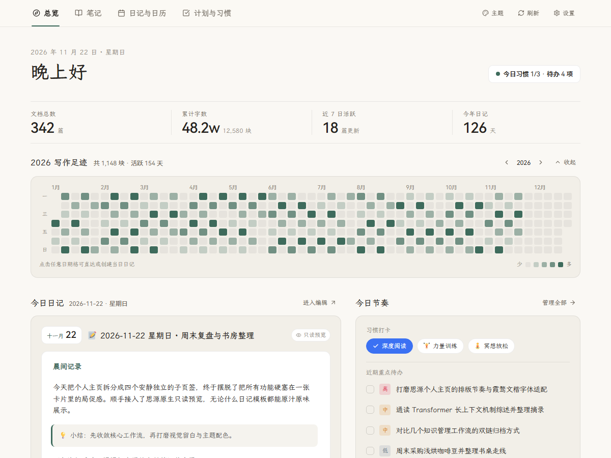

# 个人主页 (`siyuan-personal-home`)

**简体中文** | [English](./README.md)

一款清爽克制的[思源笔记](https://github.com/siyuan-note/siyuan)个人主页插件。采用四页签杂志式个人书房布局，将笔记统计与写作热力图、日记月历与思源原生只读预览、Notebook Navigator 风格笔记浏览、双维度习惯打卡与无焦虑轻量任务整合在同一个自定义标签页中。



## 核心特性

- **四页签书房布局（总览 / 笔记 / 日记与日历 / 计划与习惯）**：不占用侧边停靠栏，仅提供一个顶栏入口与快捷键 `Alt+Shift+H`（`⌥⇧H`），支持启动时自动打开。
- **笔记统计与年度写作热力图**：展示文档总数、累计字数与块数、近 7 日活跃文档数与当年日记天数；点击热力图任意日期即可直达或按模板创建当日日记。
- **日记月历与原生只读预览**：与思源默认日记本（`local-dailynoteid`）自动联动，使用思源原生只读 `Protyle` 渲染日记正文——天然兼容普通 Markdown、思源数据库、嵌入块、Callout、自定义表情与各类 HTML 挂件模板；点击标题或「进入编辑」即可在新页签编辑。
- **Notebook Navigator 风格笔记浏览**：支持「最近修改 / 最近阅读」双视图、列表与双列宽卡片布局、按时间分组、`#标签` 点击筛选、即时外观配置（0–5 行摘要、两端对齐、首行缩进、封面图与标签开关），以及按多个笔记本或父文档 ID 隐藏整棵子树。
- **双维度习惯打卡 & 无截止时间轻量任务**：支持按天连胜与按周达标连胜、本周 7 日打卡条、补卡与时长记录；轻量任务不设截止时间与催促提醒，专注优先级、自定义维度与思源文档关联。
- **独立主题配色工坊 & 字体继承**：彻底解耦思源宿主配色，内置 4 套亮色（默认「宣纸素笺」）与 4 套暗色预设，支持 6 色自由定制与持久化；同时支持自动继承思源编辑器/全局字体。
- **多端同步与备份**：使用思源插件私有 JSON 存储，支持记录级 LWW 合并、30 天软删除墓碑清理、`sync-end` 同步后自动热刷新，以及整包 JSON 导出/导入备份。

## 使用方法

1. 在思源社区集市中搜索并安装 **个人主页**，启用插件。
2. 点击顶栏主页图标，或按下快捷键 `Alt+Shift+H`（`⌥⇧H`）打开个人主页标签页（可在设置中开启「启动时自动打开」）。
3. 点击右上角 **主题** 切换或定制配色方案，点击 **设置** 配置日记本、隐藏指定笔记本/父文档 ID、字体跟随或数据备份。

## 本地开发

```bash
pnpm install
pnpm type-check
pnpm test
pnpm build
```

## 开源协议

[MIT](./LICENSE)
